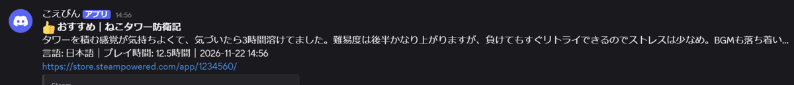

# こえびん（Koebin）— Steam新着レビュー通知ツール

Steamでゲームを販売している開発者向けの、小さな通知ツールです。
指定したタイトルの新着レビューを定期的にチェックして、Discord / Slack / Webhook に通知します。

新着通知には、レビューの本文（抜粋）のほかに、おすすめ／おすすめしないの評価、言語、プレイ時間も載ります。週に1回、直近7日間を集計した週次ダイジェストも送れます（コマンドで実行するか、タスクスケジューラ・cron に登録します）。

by Axioknot


（Discord への通知の例です。通知の1行目に評価を出します）

## 特徴

- 複数タイトルをまとめて監視できます
- 通常の通知・集計は依存ライブラリなし（Python 3.9 以上があれば動きます）
- Steamの公開APIを使うため、APIキーやログインは不要です
- 初回実行時は、既存レビューを通常の新着通知としては送りません
- こえびんは手元のPCやサーバーで動き、状態もそこに保存します。通知の送り先は設定した Discord / Slack / Webhook だけで、Axioknotのサーバーは経由しません
- 通常の新着通知が送れなかったレビューは既読にせず、次のチェックで、送れなかった送信先にだけ送り直します
- 初期設定では、取得したレビューは手元に蓄積され、週次ダイジェストと低評価の急増アラートに使えます
- 日本語以外のレビューには、翻訳で読むためのリンクを付けられます（外部の翻訳サービスへのリンクです）
- クラッシュやセーブ消失などのキーワードに一致した新着レビューは、「⚠【致命的な報告の可能性】」という別通知でも知らせます（初期状態では無効です）
- 評価ラベル（非常に好評など）が下がりそうになると、目安として事前に知らせます（初期状態では無効です）
- 初期設定では、履歴用DBを開けてレビューを取得できたチェックで、セールの開始・終了を検知した時刻と、取得できた同時プレイヤー数を記録します

## 使い方

1. 最新版のZIPを[リリースページ](https://github.com/axioknot/koebin/releases)からダウンロードし、展開します
2. `config.example.json` を `config.json` という名前でコピーします
3. `config.json` を編集します
   - `app_ids`: 監視したいゲームのApp ID（SteamのストアURL `store.steampowered.com/app/<この数字>/` の数字です）
   - 通知先（いずれか1つ以上を設定します）
     - `discord_webhook_url`: Discordの「サーバー設定 → 連携サービス → ウェブフック」で発行したURL
     - `slack_webhook_url`: SlackのIncoming WebhookのURL
     - `webhook_url`: 任意のWebhookのURL（`{"text": ...}` 形式で送ります）
   - `interval_minutes`: `--loop` 実行時の、チェック終了後の待ち時間（分）。初期値は30分です。実際の待ち時間は最低5分です
   - `fetch_count`: 1ページで取得するレビューの上限です。初期値は20です。既読のレビューIDが1件以上ある場合は、古い方へページをたどって取りに行きます（最大10ページ。既読に届かず、まだ続きがある状態で上限に達すると、取りこぼしの可能性を警告します）
   - 使わない送信先は空欄にしてください。空欄でない送信先すべてに送られます。同梱の例ではDiscordの欄に例示の文字列が入っているため、SlackやWebhookだけを使う場合はその欄を空にしてください
   - `state_file`: 既読の記録を保存するファイル名です。初期値は `state.json` で、`config.json` と同じフォルダに作られます
4. 実行します

```
python steam_review_notifier.py --config config.json          # 1回だけチェック
python steam_review_notifier.py --config config.json --loop   # 繰り返しチェック
python steam_review_notifier.py --config config.json --test   # テスト通知を設定した送信先に1通ずつ送る
```

最初は `--test` で、設定した送信先にテスト通知が届くかを確認してください。

### コマンドを使わずに実行する（Windows）

コマンドを打たずに、ファイルをダブルクリックして実行することもできます。
`check.bat`・`test-notification.bat`・`export-csv.bat` は、`config.json` を用意してから使ってください。CSVの書き出しでは、通知先のURLは空のままでも書き出せます。`ui.bat` は設定が無くても開けます。

| やりたいこと | ダブルクリックするファイル |
|---|---|
| 新着レビューのチェック | `check.bat` |
| テスト通知を送る | `test-notification.bat` |
| レビュー履歴をCSVに書き出す | `export-csv.bat` |
| ブラウザの操作画面を開く | `ui.bat` |

チェック・テスト通知・CSV書き出しの .bat は、実行すると結果が表示されます。確認したらキーを押して閉じてください。

### ブラウザの操作画面で実行する

`ui.bat` をダブルクリック（または `python koebin_ui.py --config config.json`）すると、
ブラウザで操作画面が開きます。設定を保存すると、トップ画面で新着チェック、テスト通知、CSVのダウンロードができます。調査用に、通知せずに取得するチェック、過去分の取り込み（並びと、タイトルごとの件数の上限を指定できます。100件ずつ取得して数えるため、指定した上限（1以上）を最大99件超えて保存されることがあります）、スナップショットCSVのダウンロードもできます。通知先が設定されていなくても、集める操作は使えます。

通知せずに取得するチェックで取り込んだ新着は既読になり、既読の記録が残っている間は、あとの通常チェックでも通知されません（既読は、取得に成功したチェックで、タイトルごとに直近200件までに絞られます）。再送待ちの通知も、送られずに再送待ちから外れます。急増と判定した時刻も残るため、初期設定ではその後24時間、通常チェックでもそのタイトルの急増アラートは出ません（下の「通知せずに貯める（取得のみ）」と同じ動きです）。

週次まとめは「週次まとめ」の画面で確認・送信できます。通知先URL、監視タイトル、翻訳のオン／オフは
「設定画面」で変えられます。設定の保存先は `config.json` です。
`config.json` がまだ無い場合は、開いた画面の「設定画面」からApp IDと通知先を登録します。

- 接続先は `127.0.0.1`（自分自身）のみに限定され、外部に公開されるサーバーではありません。同じネットワークの他のパソコンからも開けません。
- 操作画面を終了するときは、起動したターミナルで `Ctrl+C` を押してください。
- 操作画面からの手動チェックでも通知を送ります。先に、同じ設定で起動している `--loop` を終了してください。ロックが取れないときは、「既にチェックが実行中です（コマンド側で動いている場合も含みます）。」と表示されて終わります
- 操作画面だけでは定期的なチェックはしません。定期チェックは、本体を `--loop` で動かすか、タスクスケジューラやcronに `--loop` なしの実行を登録します（例：30分おき）

タスクスケジューラなどでは実行時のフォルダが一定しないため、`--config` には相対パスではなく
絶対パス（例：`--config C:\koebin\config.json`）を指定してください。Pythonに渡すスクリプトも絶対パスで指定するか、作業フォルダを設定してください。
状態ファイル（`state_file`）とレビュー履歴のデータベース（`reviews.db`）は、既定では `config.json` と同じフォルダに置きます。相対パスは、そのフォルダを基準に解決します。

> **注意：`config.json` は公開しないでください。** DiscordとSlackのWebhook URLは、そのURLを知っている人なら誰でもそのチャンネルへ投稿できる鍵です。公開してしまった場合は、使っている送信先のサービスで公開したWebhook URLを無効にし、新しいURLに差し替えてください。

## 通知の例

```
👍 おすすめ｜（ゲーム名）
（レビュー本文の抜粋。80字まで。個別リンクがある場合は、そこで全文を読めます）
言語: 日本語｜プレイ時間: 12.5時間｜2026-11-20 10:26
https://steamcommunity.com/profiles/（投稿者のSteamID）/recommended/（App ID）/
```

リンクは、投稿者のIDが取れた場合はレビュー個別ページへの直リンクです（権限のある開発者はリンク先から公式返信を書けます）。IDが取れなかった場合は、ストアページへのリンクになります。
プレイ時間は、レビューを書いた時点でのプレイ時間を表示します（レビュー時点の値がなければ累計を表示し、どちらの値もなければ0.0時間と表示します）。

初期設定では、Steamから言語と本文を取得できた日本語以外のレビューに、Google 翻訳への「翻訳で読む」リンクを付けます。リンクは通知の末尾に出ます。訳文を載せたときは省きます。
リンクには、前後の空白を除いた本文の先頭から、最大250文字が含まれます。リンクを開くと、その部分がGoogle翻訳に送られます。
付けたくない場合は、`config.json` の `translate_link` を `false` にしてください。
Discord と Slack では、翻訳リンクを「翻訳で読む」と表示します。こえびんは送信前に、通知全体を Discord 向けは1,900文字、Slack 向けは2,900文字で切り詰めます。翻訳リンクのURLが長いと、送信前の切り詰めでリンクの末尾が切れることがあります。

### 翻訳文の表示（任意機能）

翻訳できたときは、通知に原文と訳文の抜粋を載せます。
翻訳はOSSの機械翻訳（Argos Translate）を使います。標準のローカル設定で使う場合は、翻訳のために本文を外部へ送りません。

導入手順:

```
pip install argostranslate
argospm update
argospm install translate-en_ja
```

この手順で韓国語・中国語を日本語に訳す場合は、英語を経由します。
対象言語の「英語への変換」パッケージも入れてください（例：韓国語は `translate-ko_en`、中国語は `translate-zh_en`）。

そのうえで、`config.json` の `translate_display` を `false` から `true` に変更すると、
対応する言語で翻訳できたレビューの通知に「翻訳（機械翻訳）: …」の行が付きます。
訳文の上に原文の抜粋を残します。
記号ばかりの出力などは訳文として載せません。翻訳に失敗したときも同じです。翻訳リンクは上記の条件で付きます。
訳文が自然でも、原文と意味がずれることがあります。不具合かどうか判断するときは、通知に残した原文も見てください。

## 履歴・週次ダイジェスト・低評価の急増アラート

取得したレビューは、初期設定では設定ファイルと同じフォルダの `reviews.db`（SQLite）に蓄積されます。
今週と前週の件数・おすすめ率、急増判定の低評価率は、保存したレビューから計算します。「長期の傾向」には、取り込んだ月次集計を使います。

過去分は、履歴用DBを開けてレビューの取得に成功したときに、タイトルごとに原則1回だけ取り込みます。初期値は直近90日・1タイトルあたり2,000件までです。100件ずつ取得するので、指定した上限（1以上）を最大99件超えることがあります。上限に0を指定した場合は指定する場所によって扱いが違い、設定ファイルでは1ページ分（最大100件）を取り込んでから止まり、コマンドと操作画面では0は指定なしとして扱われ、設定値（未設定なら初期値）が使われます。設定は `config.json` の `analytics.backfill` の `days` / `max_reviews` で変更できます。取得の並びは `sort`（`recent`＝新着順／`helpful`＝参考になった順）で変更でき、参考になった順では期間で区切らず、件数の上限で止まります（`days` が効くのは新着順だけです）。並びと上限は、初回の自動取り込みにも効きます。v1.2.0 では `helpful` が実際には面白い順になっていました。v1.2.1 で直しています。参考になった順で取り直したいときは、下の `backfill --force` に `--sort helpful` を付けて取り込み直してください。ただし、v1.2.0 で取り込んだ分は履歴に残り、集計にはその分も混ざります。ページの取得に失敗した場合は、自動では取り直しません。そのタイトルは下の `--force` で取り込み直してください。
過去分の取り込み処理では通知を送りません。初回でも、条件を満たせば急増アラートや評価ラベルの注意通知は届きます。
手動で取り込み直す場合は `python steam_review_analytics.py --config config.json backfill --force` を実行してください（`app_ids` のタイトルを順に処理し、取り込み済みのタイトルも対象に含めます）。並びは `--sort`、上限は `--max-reviews`、日数は `--days` でも指定できます（`--days` が効くのは新着順だけです）。
履歴用DBを開けてレビューの取得に成功したチェックでは、`analytics.histogram.enabled` が有効なら、タイトルごとに月次集計の取得を自動で1回試みます。取得に失敗した場合は、自動では取り直しません。
こちらは手動では `python steam_review_analytics.py --config config.json import-history --force` で取り込み直せます（`app_ids` のタイトルを順に処理し、取り込み済みのタイトルも対象に含めます）。
`analytics.histogram.enabled` を `false` にすると、この取り込み（手動の取り込み直しを含む）と後述の「長期の傾向」の表示を止められます。
データベースのファイル名は `analytics.db_file` で変更できます（初期値は `reviews.db`）。
通常チェックでの履歴保存と分析用データの取得を止めるには `analytics.enabled` を `false` にしてください。週次ダイジェストの定期実行を止める場合は、その登録を解除してください（`digest` コマンドはこの設定を見ません）。

### 通知せずに貯める（取得のみ）

通知は要らず、レビューを集めて分析したいだけの場合は、`config.json` に `"fetch_only": true` と書いてください。通知先の欄（同梱の例に入っている文字列も含む）をすべて空にすると、コマンドでのチェックが動き、通知は送りません。取得したレビューは、履歴用DBを開けたチェックで履歴に保存されます。急増などのアラートも送りません。通知先の欄に1つでもURLがあれば、そちらへ通常どおり通知します。この指定がない場合、通知先が未設定だとチェックはエラーで止まります。

取得のみのチェックで急増と判定した時刻は、履歴用DBに残ります。記録した時刻から、初期設定では24時間、急増の判定を見送ります。この間は判定時刻も更新しません。同じ履歴用DBのまま通知を再開しても、この24時間が過ぎるまでは、そのタイトルの急増アラートは出ません。取得のみのチェックで新着として取り込んだレビューは、状態ファイルに既読として記録されます。あとから通知先を設定しても、既読が残っている分の新着通知は送られません。既読は、取得に成功したチェックで、タイトルごとに直近の200件までに絞られます。以前に送れずに残っていた通知（再送待ち）も、取得のみのチェックでは送られないまま再送待ちから外れます。
`backfill` で取り込んだ過去のレビューも、`export-csv` で書き出せます。

### 週次ダイジェスト

今週のレビューがある場合は、直近7日とその前の7日の件数・おすすめ率を並べます。今週分の言語の内訳（件数上位3言語。4番目以降の言語があれば「その他」にまとめます）と、参考になった数が1件以上のレビューの抜粋（最大3件。プレイ時間は累計）も載せます。レビューが0件の週は『結論：今週は新しいレビューがありませんでした』と表示します。
論点（バグ・操作性・難易度など）ごとの内訳は[論点キーワードの集計](#論点キーワードの集計)、同時プレイヤー数の行は[セールと同時プレイヤー数](#セールと同時プレイヤー数)を見てください。
月次集計の表示が有効で、月次集計を取り込んだタイトルでは、
「長期の傾向：直近○か月の月平均 ○○件｜おすすめ率 ○○%」の1行も入ります（取り込んだ月のうち、新しい順に最大12か月分を使います。欠けた月は平均に含めません。集計に使った月のレビューが合計0件なら表示しません）。

```
python steam_review_analytics.py --config config.json digest
```

週に1回、タスクスケジューラやcronで実行する想定です。`--dry-run` を付けると、通知先には送らず、内容を標準出力に表示します。

表示例（タイトルとレビュー本文は例示用に変えています。論点・同時プレイヤー数・長期の傾向の行は省いています）：

```
📊【週次ダイジェスト】サンプルゲーム（11/13〜11/20）
結論：好調です（おすすめ率 80%）
今週：10件（前週 5件）｜👍 8 / 👎 2｜おすすめ率 80%（前週 60%）
言語：日本語 5件、英語 3件、韓国語 2件
▼ 参考になったレビュー
1. 👍｜120時間｜参考になった 45件
「アップデートで追加された新モードが面白い」
https://steamcommunity.com/profiles/76561198000000000/recommended/1234560/
（以下略）
```

### レビュー履歴のCSV書き出し

```
python steam_review_analytics.py --config config.json export-csv
```

Windows では `export-csv.bat` をダブルクリックしても書き出せます。

`config.json` と同じ場所に `koebin-reviews.csv` ができます。
書き出し先を変える場合は `--output reviews.csv` を付けます。対象は `app_ids` に指定したタイトルで、`app_ids` が空か未指定なら、DB内の全タイトルを出力します。`--appid 1234560` を付けると、そのタイトルだけに絞れます（監視対象から外したタイトルの履歴も指定できます）。
文字コードは BOM付きUTF-8 で、Excelでそのまま開けます。
含まれるのは、投稿日時・取得日時、タイトル、評価（おすすめ／おすすめしない）、言語、
役に立った数、プレイ時間、レビュー本文、レビューへのリンクなどで、タイトルごとに投稿日時の古い順に並びます。


### 記録した数値の時系列のCSV書き出し

```
python steam_review_analytics.py --config config.json export-snapshots
```

記録したスナップショット（タイトルごとのレビュー総数・好評数・不評数・評価ラベル・同時プレイヤー数・割引率）を、時系列で書き出します。
`config.json` と同じ場所に `koebin-snapshots.csv` ができます。書き出し先を変える場合は `--output snapshots.csv` を付けます。対象は `app_ids` に指定したタイトルで、`app_ids` が空か未指定なら、記録のある全タイトルを出力します。`--appid 1234560` を付けると、そのタイトルだけに絞れます。
並びはタイトルごとに記録日時の古い順です。記録されなかった項目は空欄になります。文字コードは BOM付きUTF-8 で、Excelでそのまま開けます。

### 低評価の急増アラート

通常のチェックでは、履歴用DBを開けて、レビューの取得に成功したときに急増を判定します。初期設定のしきい値では、直近24時間のレビューが5件以上・低評価が3件以上あり、
低評価の割合が、その直前28日間（直近24時間を除く）の割合より20ポイント以上高く、かつ30%以上になったときだけ、
直近と平常時の低評価の割合などを載せたアラートを送ります。比較に使う直前28日間のレビューが0件の間は出ません。低評価の割合が平常時よりちょうど20ポイント高いときは、計算の丸めでアラートが出ないことがあります。
アラートには、直近24時間の低評価レビューの抜粋（新しい順に最大3件。投稿者のIDが取れたものには個別のリンク）が付きます。平常時の件数を直近24時間と同じ長さに換算して、低評価の増加が1件以上の言語があれば、その内訳も載せます（増加幅の大きい順に最大3つ。例：中国語（簡体字） +5）。
しきい値は `config.json` の `analytics.surge` で変更できます
（`min_recent_reviews` 直近の件数の下限、`ratio_delta` 平常時の低評価率を何ポイント上回るか。20ポイントなら `0.2`、など）。
同じタイトルへのアラートは、初期設定では24時間に1回までです。

### イベント前後の比較

アップデートのような「イベント」を境に、その前後の7日間ずつで、レビューの件数・おすすめ率と言語の内訳（前後それぞれ件数が多い上位3言語）を比べます。
イベント比較が有効な場合、週次ダイジェストには、集計時点までの最新のイベントについて「▼ イベント前後の比較」のセクションが付きます（前7日・後7日の件数とおすすめ率、言語の内訳）。イベントが無いタイトルでは付きません。イベント後のレビューは、7日たつまでは集計した時点までの分を数えます。

イベントは、そのゲームの公式発表から候補を取り込めます（手動登録と、後述のセール検知による登録もあります）。Steamの公式ニュースAPI
（ISteamNews/GetNewsForApp、`feeds=steam_community_announcements`）で発表を取得し、
タイトルに `update` `patch` `アップデート` などを含むものや、「1.6.14」のような
バージョン番号らしい文字列を含むものを「イベント候補」として自動で登録します
（自動取り込みが有効で、履歴用DBを開けてレビューの取得に成功したチェックで告知を取得します。自動同期後24時間は次の自動取得を行いません）。
候補にするキーワードは `config.json` の `analytics.events.keywords` で変更でき、
`analytics.events.enabled` を `false` にすると、候補の自動取り込みとダイジェストの比較表示を止められます（`add-event`・`remove-event` はそのまま使えます）。

```
python steam_review_analytics.py --config config.json sync-events   # 公式発表から候補を取り込む（イベント設定が有効な場合）
python steam_review_analytics.py --config config.json events        # 登録済みイベントの一覧
python steam_review_analytics.py --config config.json add-event --appid 1234560 --date 2026-11-15 --title "大型アップデート"
# 手動登録では、入力した日付の UTC 00:00（日本時間09:00）が前後比較の境になります
python steam_review_analytics.py --config config.json remove-event --appid 1234560 --event-id feed-456
```

- 告知のないアップデートは拾えません（その場合は `add-event` で足してください）
- 判定は告知のタイトルだけで行うため、実際のアップデートでない告知が候補に入ることがあります。比較から外したい告知は `remove-event` で削除できます。同じ告知が同期の対象に残っていれば、次の同期でまた登録されます
- レビューにはゲームのバージョンが入っていません。アップデートのあとでおすすめ率が下がっても、アップデートが原因かは、この数字だけでは分かりません

### 致命的な報告の別通知（任意・初期状態では無効）

チェックで見つけた新着レビューに辞書の語があれば、その回に「⚠【致命的な報告の可能性】」という別通知も送ります。別通知も、送れなかった送信先には次のチェックで送り直します。語の一致で判定するため、誤報や見落としがあります。
使う場合は `config.json` の
`analytics.fatal_alerts` の `enabled` を `true` にしてください。

```json
"fatal_alerts": {
  "enabled": true,
  "extra_keywords": [],
  "per_app_keywords": {}
}
```

初期の辞書は日本語・英語・中国語で、クラッシュ、起動しない、セーブデータの消失・破損、
crash、won't start、save corrupted、闪退、存档丢失、黑屏 などを含みます。
語は `config.json` の `analytics.fatal_alerts` の `extra_keywords` で全タイトル共通に追加でき、
`per_app_keywords` でタイトル固有の語も足せます。

一部の否定表現（「クラッシュしません」「no crashes」など）は判定から外します。

### 評価ラベルの陥落アラート（目安・任意・初期状態では無効）

Steamの実際の評価ラベルとずれることがあるため、初期状態では無効にしています。使う場合は `config.json` の
`label_alert` の `enabled` を `true` にしてください。

```json
"label_alert": {
  "enabled": true,
  "warn_within": 5
}
```

有効にすると、あと何件の低評価でおすすめ率が今のラベルの目安を下回るかを計算します。Steamから集計値が取れ、今のラベルにおすすめ率の下限があるときに計算します。Steamが返したラベルを判定に使えない場合は、総件数とおすすめ率から今のラベルを推定します。
下限を割ったときの推定ラベルが現在のラベルと異なり、残りがしきい値（初期値5件、`config.json` の `label_alert.warn_within`）以内になったときだけ通知します。
最後に送れたときと同じラベル・残り件数のままなら、通知しません。残り件数がしきい値より増えると、次に条件を満たしたときはまた通知します。

Steamの評価スコアに反映されるのは、Steamで購入してプレイしたアカウントのレビューだけです。Steamキーで入手したゲームのレビューはスコアに入りません。こえびんの推定は、購入経路で絞らずにSteamから取得した総件数とおすすめ数から計算します。

### 論点キーワードの集計

週次ダイジェストに、その週のレビューを論点ごとに数えた内訳が1節入ります（論点集計が有効で、キーワードに該当するレビューがある場合）。
初期設定の論点は、更新、MOD、AI素材、オンライン、バグ、難易度、ローカライズ、操作性、価格、パフォーマンス、設計の11です。論点の件数はキーワードの一致で数えた目安です。手元の測定では、難易度・設計・価格・AI素材は、その論点に分類された低評価の半数以上を拾えていませんでした。v1.2.0 で初期の論点の名前が変わりました（バグ・不具合→バグ、翻訳・日本語→ローカライズ、価格・ボリューム→価格）。設定で旧名の論点に語を足していた場合、その論点は旧名のまま別に残ります。新しい論点に寄せるときは、設定の名前を新しい名前に変えてください。
各論点について、該当件数と、そのうち低評価の件数を出します。
辞書は日本語・英語・中国語を用意し、`config.json` の `analytics.topics` で
作品固有の語を追加できます（`enabled` で無効化もできます）。
辞書の語で数え（一部の否定表現は除きます）、AIは使いません。冗談で「難しすぎる」と書いたレビューも、難易度の件数に入ります。

### セールと同時プレイヤー数

初期設定では、レビューの取得に成功し、履歴用DBを開けたチェックで、割引率と同時プレイヤー数も取りに行きます。取れた値を記録します。割引率は日本向けSteamストアの値です。

- 割引の開始と終了を検知すると、イベントとして自動で登録します（例：「セール開始（-40%）」。開始・終了を検知したチェックの時刻を登録し、比較対象に選ばれた場合は、その検知時刻を境に集計します。初回から割引中なら、そのチェックを開始として記録します）。
  `analytics.sale_events.enabled` を `false` にすると、セールの検知とチェック時点の割引率の記録を止められます。ストア基本情報の取得は別の設定で動くため、この設定を無効にしても、価格の履歴に割引率が残ることがあります
- 同時プレイヤー数は時系列で貯まり、週次ダイジェストに
  「同時プレイヤー：今週の平均 ○○人・最大 ○○人（先週の平均 ○○人）」の1行が入ります
  （今週の記録が無ければ行自体を出しません。先週の記録が無ければ、先週の平均は省きます）。`analytics.players.enabled` で止められます


### 参考タイトル（競合を含む）のウォッチ

監視対象は、自分のゲームでなくても構いません。他のゲームを監視するときも、`app_ids` にそのゲームの App ID を入れます。

### 通知の見た目

- 新着レビュー：初期設定では、1行目に評価（👍 おすすめ／👎 おすすめしない）とタイトルを置き、本文の抜粋、補足（言語・プレイ時間・日時）、リンクの順に並べます
- 週次ダイジェスト：1行目は「📊【週次ダイジェスト】タイトル（期間）」で、2行目に結論を置きます
- 急増アラート：1行目は「🚨【低評価の急増】タイトル」で、2行目に直近の低評価の件数と割合を置きます

今の版の通知はテキストだけで、評価による色分けはしません。

## 取得している情報の一覧

Steamの公式Web APIと、ストアの公開エンドポイント（どちらもAPIキー不要）から取得します。履歴保存が有効でDBを開けたチェックでは、取れたレビューや集計値を手元のSQLiteに保存します。

- レビュー：評価、言語、本文、参考になった数、おもしろい数、参考になった度合いのスコア（weighted_vote_score）、
  コメント数、投稿・更新時刻、投稿者のプレイ時間（累計・直近2週間・レビュー時点）、
  Steam購入かどうか、投稿者が無料で受け取ったと申告したか、早期アクセス中の投稿かどうか、返金済みかどうか、
  開発者返信の有無と時刻、返信の本文、投稿者のレビュー数
- 投稿者のSteamIDと生JSON：SteamIDは、レビューへのリンクを作るために使うので、SQLiteの専用列に保存します。生JSONのコピーでは `author.steamid` を除き、レビュー本文などはそのまま保存します。APIが返した場合は、レビュー時のSteam Deckでのプレイ時間やハードウェア情報も含まれます
- レビューへのリンク：週次ダイジェストと急増アラートの抜粋にも、投稿者のIDが取れたものには個別のリンクを付けます
- 集計値の記録：総レビュー数・おすすめ数・低評価数と公式の評価ラベル（query_summary）、
  同時プレイヤー数（`analytics.players.enabled` が有効な場合）、割引率（`analytics.sale_events.enabled` が有効な場合）
- 月ごとのおすすめと低評価の件数も保存します。Steamから取得できた期間について取り込み、
  週次ダイジェストの「長期の傾向」に使います。取り込むのは月単位の件数集計だけで、
  レビュー個別のデータではありません
- ストアの基本情報（ジャンル、カテゴリ、開発元／パブリッシャー、発売日、
  対応言語、価格（割引率を含む）、メタスコアなど）。`analytics.metadata.enabled` が有効な場合にチェック時に取得し、前回の取得成功から24時間は再取得しません。履歴へ保存するのは初回と変更時だけです（止めるには `analytics.metadata.enabled` を `false` にします）
- 全実績の達成率のスナップショット（`analytics.achievements.enabled` が有効な場合、取得して保存できた後は、初期設定では7日間取り直しません。取れなかった場合は、次の対象チェックでまた試みます。現時点では保存までで、集計には使っていません）
- 公式発表：イベント候補のID、タイトル、公式発表の時刻、URL。取得元は `ISteamNews/GetNewsForApp` です

出典は、レビュー取得API（IUserReviewsService/GetAppReviews）、ストア情報（appdetails）、
同時プレイヤー数（ISteamUserStats/GetNumberOfCurrentPlayers）、
実績達成率（ISteamUserStats/GetGlobalAchievementPercentagesForApp）、
公式発表（ISteamNews/GetNewsForApp）です。
月次集計の出典は `store.steampowered.com/appreviewhistogram` で、公開仕様を確認できないエンドポイントなので、Steam側の変更で取得できなくなることがあります
（その場合も、新着通知と直近7日間の集計は続きます）。

- 同時プレイヤー数と割引率は、チェックした時点の値を記録します。チェックしていない時間帯の動きは分かりません
- こえびんはウィッシュリスト数や売上を取得しません
- 同時プレイヤー数や割引率が取れなくても、新着レビューの通知は続きます。ストア基本情報や公式発表の取得に失敗した場合は、履歴用DBを開けてレビューの取得に成功した次のチェックで取り直します（各機能が有効な場合）。ただし、Steamから発表が1件も返らなかったときは、24時間たつまで取り直しません
- Steam APIからのレビュー取得に失敗したタイトルは、その回は履歴を保存せず、同時プレイヤー数と割引率の記録やアラートの判定も見送ります。再送待ちの通知は、レビューを取りに行く前に再送を試みます

## 注意と運用について

- 公開から90日間の利用状況を見て、保守を続けるか決めます。保守をやめた場合、その後のSteam側の仕様変更で取得できなくなることがあります
- 保守の対象はSteam側の仕様変更です。変更によっては対応できないことがあります
- 再送待ちの通知がある場合は、送信先のURLを変更すると、変更後のURLへ送ります。チェックを実行した時点で設定から外れている送信先は、再送待ちから外れます
- 通常チェックで取得するのは直近のレビューです（1回の取得件数に上限があります）。チェック間隔が空きすぎると取りこぼす場合があります。こえびんはAPIキーを使わずに取得するため、Steam側の回数制限が厳しく（制限に達すると、その回の取得ができません）、応答は最長10分キャッシュされることがあります
- SteamのレビューAPIは2026年10月に移行が告知され、10月22日に旧エンドポイント `store.steampowered.com/appreviews/<appid>?json=1` での一括取得が廃止されました。こえびんは現在、`IUserReviewsService/GetAppReviews` でレビューを取得しています。出典：[Changes to Steam User Reviews API（Steamworks Development 公式アナウンス）](https://store.steampowered.com/news/group/4145017/view/676258795703241580)
- Steam がオフトピックなレビュー活動（レビュー爆撃など）を認定した期間に投稿されたレビューは、APIの既定の設定で取得対象から外れます
- 通知にはレビュー本文の抜粋が流れます。翻訳リンクが付く場合は、そのリンクにもレビュー本文の一部が含まれます。チームで使う場合は特に、非公開のチャンネルで使ってください。Issueには実際のレビュー本文、DBファイル、WebhookのURLを貼らないでください
- 履歴には、過去分の取り込みと通常チェックで保存できたレビューが入ります。停止中の分も、再開後の取得範囲に入れば保存します
- 履歴用DB（`reviews.db`）を開けなかったチェックでは、履歴への保存・取り込み、同時プレイヤー数と割引率の記録、低評価の急増判定はしません。有効にした致命的な報告の別通知と評価ラベルは、DBを開けなくても判定します。レビューの取得に失敗したタイトルは、その回の判定を見送ります

## ライセンス

MIT License
